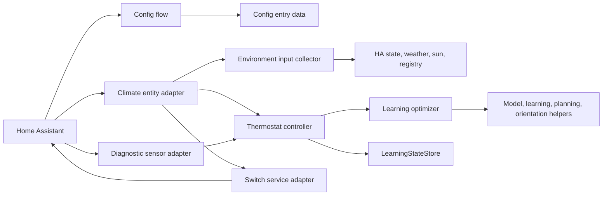
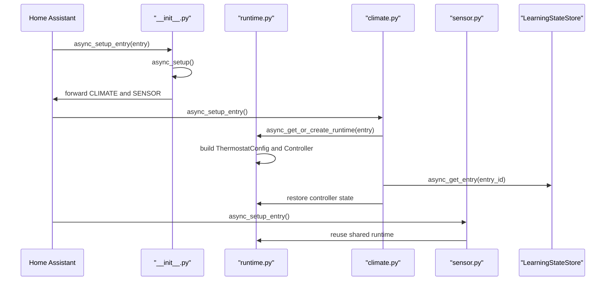
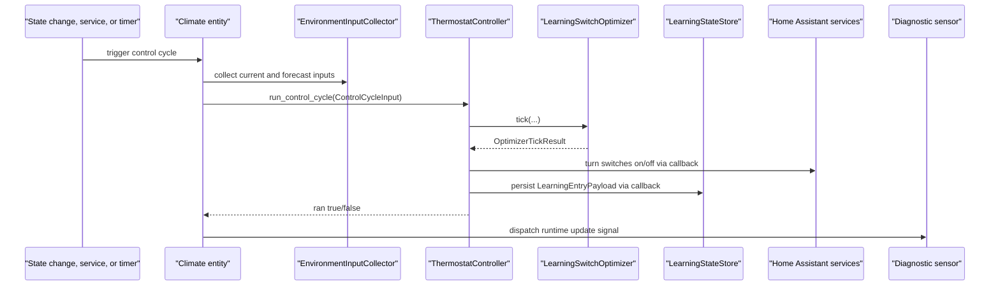

# Architecture

## Project Overview

`learning_thermostat` is a standalone Home Assistant custom integration for
hydronic underfloor heating controlled by direct on/off entities. Its normal
user-facing runtime is one Home Assistant `climate` entity per config entry,
with a diagnostic `sensor` entity for learned solar orientation.

The integration reads room temperature, optional outdoor temperature or weather
forecast data, optional weather-provider solar irradiance data, and the current
state of configured `switch` or `input_boolean` entities. It writes only through
standard Home Assistant `turn_on` and `turn_off` services for those configured
output entities.

Durable data is split between Home Assistant config entries and an integration
storage document. Config entries own setup-time configuration. The storage
document owns learning snapshots, last tick time, and restored temperature
context used by the controller and migration utility.

## Architecture Overview

The current architecture is a narrow Home Assistant adapter around a
Home Assistant-free thermostat core. The climate entity collects Home Assistant
state, translates it into plain controller input contracts, calls the
controller, then applies controller decisions through Home Assistant services.
The controller owns thermostat orchestration and delegates prediction, learning,
planning, and solar-orientation inference to the optimizer family.

Major parts:

- Core policy: `controller.py`, `optimizer*.py`, `solar.py`, `state.py`,
  `config_contract.py`, `attributes.py`, and constants/defaults.
- Home Assistant adapters: setup, config flow, climate entity, diagnostic
  sensor, input collectors, switch/weather/solar adapters, services, runtime,
  storage, and migration helpers.
- Durable storage: Home Assistant config entry data plus
  `learning_thermostat_state` via `homeassistant.helpers.storage.Store`.
- Delivery tooling: Drone pipeline and scripts for bootstrap, tests, deploy,
  packaging, and migration.



## Boundaries And Invariants

- The supported control model is direct on/off switching only. The configured
  output entities must be `switch` or `input_boolean` entities that accept
  standard `turn_on` and `turn_off` services.
- The core modules must not import Home Assistant. This is enforced by
  `tests/test_architecture.py`.
- Home Assistant specific state reads, service calls, config entry operations,
  entity lifecycle, storage I/O, weather API calls, and entity-registry lookup
  are adapter responsibilities.
- `ThermostatController` is the application service for thermostat behavior. It
  owns restore, reset, tick interval gating, optimizer lifecycle, persisted
  payload construction, and switch decision orchestration.
- `LearningSwitchOptimizer` owns learned model state, histories, pending
  predictions, planning state, and solar-orientation inference. Adapters do not
  construct it directly.
- `LearningStateStore` serializes writes with an `asyncio.Lock`; stored entries
  are keyed by Home Assistant config entry id.
- Climate attributes are diagnostic and compact. The canonical learning
  snapshot stays in integration storage, not in recorder attributes.
- Config uniqueness is based on the sorted configured switch set, so two
  entries cannot manage the same underlying switch set through normal config
  flow paths.
- The integration intentionally has no translation infrastructure in this repo,
  even though entities and services expose Home Assistant translation keys.

## Repository Mapping

- `custom_components/learning_thermostat/controller.py` owns thermostat
  application orchestration and is independent of Home Assistant imports.
- `custom_components/learning_thermostat/optimizer.py` and
  `custom_components/learning_thermostat/optimizer_*.py` own online learning,
  model layout, history, tracking, planning, snapshot/restore, and
  solar-orientation training.
- `custom_components/learning_thermostat/solar.py` owns Home Assistant-free
  solar sample/profile math and compass labeling.
- `custom_components/learning_thermostat/state.py`,
  `config_contract.py`, `learning_defaults.py`, `attributes.py`, and
  `const.py` define stable contracts, defaults, compact diagnostics, and
  identifiers shared by core and adapters.
- `custom_components/learning_thermostat/climate.py` is the primary runtime
  adapter. It owns Home Assistant entity behavior, listeners, scheduled ticks,
  service handlers, restore entry points, and switch actuation callbacks.
- `custom_components/learning_thermostat/environment_input.py`,
  `weather_input.py`, `solar_input.py`, and `switches.py` translate
  Home Assistant state, weather APIs, entity registry data, sun-position data,
  and services into plain contracts used by the controller.
- `custom_components/learning_thermostat/__init__.py`, `runtime.py`,
  `sensor.py`, `services.py`, `storage.py`, `config_flow.py`, and
  `migration.py` own setup lifecycle, shared per-entry runtime objects,
  diagnostic sensor state, entity-service registration, storage I/O, config
  entry creation/editing, and legacy state migration.
- `tests/` contains fast unit and Home Assistant integration-style tests,
  including explicit architecture boundary tests.
- `.drone.yml` and `scripts/` define local CI/CD, deployment to the Home
  Assistant custom components directory, packaging, and migration support.
- `assets/brand/*.svg` are editable branding sources; runtime PNGs are tracked
  under `custom_components/learning_thermostat/brand/`.

## Components

### Thermostat Core And Controller

`ThermostatController` in `controller.py` owns use-case orchestration for one
thermostat entry. It consumes a `ThermostatConfig`, stores current runtime
state, restores from `LearningEntryPayload`, and emits persistence payloads with
`build_entry_payload`.

Main responsibilities:

- Track HVAC mode, target temperature, current room temperature, outside
  temperature, solar input, last learning result, last tick, and current
  on-percent decision.
- Enforce the minimum cycle interval unless the caller forces a tick.
- Turn all configured outputs off immediately when mode is `off`.
- Build or restore `LearningSwitchOptimizer` lazily through an injected factory.
- Rebuild the optimizer when solar availability changes, preserving snapshots
  where possible.
- Delegate output writes and persistence through callback parameters, keeping
  Home Assistant side effects outside the controller.

The controller depends on optimizer and state contracts, but not on Home
Assistant. Its behavior is covered by `tests/test_controller.py`, and
architecture rules verify that `climate.py` does not construct the optimizer
directly.

### Learning Optimizer

`LearningSwitchOptimizer` in `optimizer.py` owns online prediction, learning,
planning, and optimizer snapshot state. It consumes current room temperature,
outdoor temperature, target temperature, forecast temperatures, optional solar
flux/sample data, current switch state, cycle duration, and timestamp. It
returns an `OptimizerTickResult` with the planned output and compact diagnostics.

Important subcomponents:

- `optimizer_model.py` owns model family selection, feature layout, default
  weights, and weight index calculations.
- `optimizer_features.py` builds linear and physical model feature vectors.
- `optimizer_history.py` updates latest-first histories and builds padded model
  arrays.
- `optimizer_learning.py` computes single-step and multi-step weight updates.
- `optimizer_planning.py` normalizes forecasts, rolls out predictions, and
  searches for a single contiguous on interval.
- `optimizer_tracking.py` records matured k-step prediction errors, dynamic
  lookahead statistics, and pending prediction queues.
- `optimizer_memory.py` owns mutable optimizer memory and serializes/restores
  snapshots through `optimizer_state.py`.
- `optimizer_orientation.py` scores compact two-facade solar orientation
  candidates and exposes sorted diagnostic contributions.

The optimizer uses NumPy and logging, but no Home Assistant APIs. Its state is
serialized through a snapshot contract containing weights, model metadata,
histories, learning rates, k-step statistics, solar orientation diagnostics,
and last plan data. `tests/test_optimizer.py` covers snapshot contracts,
restore/adaptation paths, deterministic tick behavior, dynamic lookahead,
learning update payloads, solar model expansion, physical model behavior, and
solar orientation diagnostics.

### Solar And Environmental Inputs

`solar.py` is the core solar math module. It defines `SolarSample`,
`SolarProfile`, diffuse solar features, fixed compass-bin profile helpers, and
the current compact orientation feature shape: diffuse flux plus two
perpendicular facade exposure channels.

Home Assistant-facing input collection lives outside the core:

- `environment_input.py` builds `CurrentEnvironmentInput` and
  `ControlCycleInput` from Home Assistant state.
- `weather_input.py` reads current outdoor temperature from sensors or weather
  attributes and fetches forecast temperatures through Home Assistant weather
  APIs when needed.
- `solar_input.py` auto-detects supported weather-provider solar irradiance
  sensors linked to the configured weather entity, builds current solar samples
  from `sun.sun`, and computes forecast sun position with Astral when possible.
- `switches.py` reads current output state and applies output decisions through
  Home Assistant services.

The adapter boundary is intentionally explicit: `CurrentEnvironmentInput` and
`ControlCycleInput` are plain data contracts, and
`tests/test_environment_input.py` plus `tests/test_architecture.py` protect that
shape.

### Home Assistant Runtime Adapters

`__init__.py` initializes domain data, creates the shared `LearningStateStore`,
sets up runtime dictionaries, forwards config entries to `climate` and `sensor`
platforms, unloads platforms, removes per-entry runtime objects, and deletes
stored learning state on entry removal.

`runtime.py` creates a shared `LearningThermostatRuntime` per config entry. The
runtime holds a normalized `ThermostatConfig`, one `ThermostatController`, and
an update signal used by diagnostic sensors.

`climate.py` is the primary adapter. It:

- Exposes the Home Assistant climate entity with `heat` and `off` modes.
- Restores HVAC mode and target temperature from Home Assistant restore state.
- Restores learning state from `LearningStateStore`.
- Registers listeners for room temperature, outdoor source, detected solar
  source, switch state changes, and periodic scheduled ticks.
- Runs forced ticks on mode or target changes and unforced ticks on the cycle
  timer.
- Converts controller decisions into `turn_on` or `turn_off` service calls.
- Emits compact diagnostic climate attributes and dispatches runtime updates
  after ticks.

`sensor.py` exposes one diagnostic sensor for learned solar orientation. It
shares the same runtime/controller as the climate entity and updates when the
climate entity dispatches the per-entry update signal.

`services.py` registers two entity services once per Home Assistant platform:
`learning_thermostat.reset_learning` and
`learning_thermostat.trigger_tick`. The exhaustive service metadata lives in
`services.yaml`.

### Config And Persistence

`config_flow.py` owns user and options flows. It accepts a name, one or more
underlying switch or input-boolean entities, a room temperature sensor, an
optional outdoor sensor or weather entity, cycle timing, target/min/max
temperature, learning model, lookahead/history sizes, and learning
hyperparameters. It normalizes entry data with `normalize_config_entry_data`
and rejects duplicate switch sets through the entry unique id.

`config_contract.py` converts config entry data into the Home Assistant-free
`ThermostatConfig`. It also bridges older outdoor configuration keys and maps
weather entities into the outdoor/forecast path.

`storage.py` persists one `LearningEntryPayload` per config entry under
`learning_thermostat_state`. The payload contains the optimizer snapshot,
last tick time, current room temperature, and outside temperature. The store
serializes read-modify-write operations with a lock.

`migration.py` is an offline/helper path for preserving learning state from
`versatile_thermostat`. It extracts legacy `learning_state` and
`learning_last_tick`, resolves a target entry id from Home Assistant storage,
backs up the storage file, and writes a new integration storage document. It
does not migrate the broader source integration feature surface.

### Diagnostics And Attribute Surface

`attributes.py` builds climate diagnostic attributes from controller and
optimizer state. It deliberately summarizes `learning_plan`,
`learning_update`, and `learning_tracking` and avoids exposing raw optimizer
snapshots in Home Assistant state attributes.

The diagnostic surface includes the current learning model, schema version,
last tick, outdoor and solar inputs, learned solar orientation, on-percent,
underlying entities, outdoor/forecast entity ids, solar entity ids, compact
planning data, compact update data, and prediction tracking metrics.

This split keeps recorder payloads small while preserving the full learning
snapshot in integration storage.

### CI, Deployment, And Packaging

`.drone.yml` defines the local pipeline:

- `bootstrap-check` validates package layout from Alpine.
- `test-home-assistant` installs dev dependencies with `uv`, runs Black in
  check mode, and runs pytest.
- `deploy-home-assistant` copies tracked custom components into the mounted
  Home Assistant config directory and requests a Home Assistant restart on
  `main` pushes or custom runs.
- `package-components` creates release artifacts on tags.

Local script entry points mirror those pipeline responsibilities:
`scripts/run-ci-tests.sh`, `scripts/bootstrap-check.sh`,
`scripts/deploy-home-assistant.sh`, `scripts/package-components.sh`, and
`scripts/migrate_learning_state.py`.

## Data And Control Flow

### Setup Flow



### Control Cycle Flow



The controller returns `False` without side effects when an unforced tick is
inside the configured cycle interval, when the room temperature is missing, or
when the optimizer rejects invalid numeric input. When HVAC mode is `off`, the
controller turns outputs off and persists immediately.

### Learning State Flow

The optimizer snapshot is the canonical learning model state. The flow is:

1. `LearningSwitchOptimizer.snapshot_state()` builds a JSON-serializable
   snapshot through optimizer memory/state helpers.
2. `ThermostatController.build_persisted_payload()` wraps the snapshot with
   last tick and temperature context.
3. `LearningStateStore.async_save_entry()` writes the payload under the config
   entry id.
4. On startup, `LearningThermostatEntity._async_restore_runtime_state()` reads
   Home Assistant restore state and the store payload, then calls
   `ThermostatController.restore()`.
5. The optimizer is rebuilt lazily and restored from the controller snapshot on
   the next control cycle.

Snapshot compatibility and layout adaptation are owned by `optimizer_state.py`
and `optimizer_memory.py`, not by Home Assistant entities.

## Public Surfaces

- Home Assistant integration domain: `learning_thermostat`.
- Platforms: `climate` and `sensor`.
- Config flow: one user flow and one options flow, both backed by the schema in
  `config_flow.py`.
- Climate entity: supports `heat`, `off`, target temperature, `turn_on`, and
  `turn_off`.
- Diagnostic sensor: one per entry, reporting learned solar orientation.
- Entity services:
  - `learning_thermostat.reset_learning` with optional `preserve_history`.
  - `learning_thermostat.trigger_tick` with optional `force`.
- Persistent storage key: `learning_thermostat_state`.
- Migration CLI: `uv run python scripts/migrate_learning_state.py ...`.
- CI/deploy scripts: `scripts/run-ci-tests.sh`,
  `scripts/deploy-home-assistant.sh`, `scripts/package-components.sh`, and
  `scripts/bootstrap-check.sh`.

The service descriptions in `services.yaml` and setup instructions in
`README.md` are the better source of truth for user-facing wording. This
document records which architectural component owns each surface.

## Extension Points

Established seams in code:

- `ThermostatController` accepts injected optimizer, clock, switch-writer, and
  persister callables, which supports focused controller tests without Home
  Assistant.
- `ThermostatConfig` is the normalized configuration boundary between config
  entry data and runtime behavior.
- `ControlCycleInput` is the plain input boundary between Home Assistant state
  collection and core control behavior.
- `LearningSwitchOptimizer` supports linear and physical model families through
  model/component helpers and snapshot model ids.
- Solar input is optional and can be enabled after restore by rebuilding the
  optimizer from a snapshot with solar features enabled.
- `optimizer_state.py` owns snapshot adaptation for older or different weight
  layouts.
- `LearningStateStore` isolates Home Assistant storage mechanics from
  controller and optimizer logic.

Inferred but not yet broad extension points:

- Additional weather providers can fit through `weather_input.py` if they expose
  current and forecast temperature in Home Assistant-supported shapes.
- Solar providers must expose average irradiance in `W/m²` at the adapter
  boundary. Pirate Weather provides that shape directly. Bright Sky support uses
  only the derived `solar_irradiance_*` sensors and intentionally ignores raw
  Bright Sky `solar_*` interval irradiation values in `kWh/m²`.
- Additional thermostat device classes are not an intended extension point
  under the current product boundaries.

## Testing And Verification

The test suite is organized by boundary:

- `tests/test_architecture.py` protects the core/adapter split, module
  classification, Home Assistant import boundaries, and controller access path.
- `tests/test_controller.py` proves controller behavior with stubbed optimizer,
  switch writer, persistence, and clock dependencies.
- `tests/test_optimizer.py` covers optimizer model contracts, deterministic
  ticks, snapshot/restore, model adaptation, k-step tracking, dynamic lookahead,
  physical model features, and solar-orientation behavior.
- `tests/test_solar.py` covers Home Assistant-free solar exposure math and
  compass labeling.
- `tests/test_environment_input.py`, `tests/test_climate.py`,
  `tests/test_config_flow.py`, and `tests/test_init.py` cover Home Assistant
  adapter wiring, input collection, entity services, weather/solar detection,
  config flows, and platform setup.
- `tests/test_attributes.py` protects recorder-safe diagnostic compaction.
- `tests/test_migration.py` covers legacy payload extraction and storage
  document writes.

The repo-standard local check is:

```bash
uv run pytest -q
```

The Drone test step also runs:

```bash
.venv/bin/black --check custom_components tests scripts
```

## Change Management

Update this document alongside code when a change:

- Moves logic across the core/adapter boundary.
- Adds or removes Home Assistant platforms, services, entities, or storage keys.
- Changes the optimizer snapshot schema, model ids, learning-state persistence,
  or migration assumptions.
- Changes the control model beyond direct on/off switches.
- Changes solar/weather provider ownership or the input contracts passed into
  the controller.
- Changes CI/CD deployment assumptions or the runtime branding source of truth.

## Architecture Discussion

Current alignment with the repository guidance is mostly strong. The thermostat
decision path has a clear owner: `ThermostatController` owns application
orchestration, while `LearningSwitchOptimizer` owns learning and planning. The
Home Assistant climate entity is still the busiest adapter, but its work is
mostly entity lifecycle, listener registration, input collection, restore
bridging, and service callbacks rather than optimizer policy.

Coupling is actively constrained by tests. Core modules do not import Home
Assistant, adapter modules are classified explicitly, and config contracts avoid
depending on optimizer internals. The one-way dependency direction is visible:
Home Assistant adapters depend on controller/config contracts, controller
depends on optimizer and state contracts, and optimizer subcomponents depend on
numeric/core helpers.

Side effects are mostly at adapter boundaries. Home Assistant service calls,
weather forecast calls, entity-registry lookup, storage I/O, restore-state
reads, dispatcher signals, and deployment scripts are outside the core. The
controller receives side-effect callbacks instead of importing those adapters.

The abstractions are semantically real for the current repo. `ThermostatConfig`,
`ControlCycleInput`, `LearningEntryPayload`, `LearningThermostatRuntime`, and
`LearningStateStore` describe actual boundaries used by code and tests. The
architecture tests also guard against speculative broad interfaces in core
modules.

Confirmed gaps:

- `climate.py` remains a large adapter because it owns Home Assistant entity
  lifecycle, scheduling, restore, diagnostics, input refresh, and service
  handlers. This is acceptable currently, but future adapter growth should be
  watched closely.
- `optimizer.py` is still the largest core module and coordinates many
  subcomponents. The helper modules reduce internal complexity, but the tick
  method remains the central learning/planning pipeline.
- Translation keys exist without translation files by design. New contributors
  should not mistake that for missing translation infrastructure to add back.

Inferred delta from the architecture vision in `AGENTS.md`:

- The current implementation already reflects the major vision: focused on
  underfloor on/off control, Home Assistant at the boundary, core behavior
  testable without Home Assistant, and no broad thermostat framework.
- The next likely architectural improvement is not another abstraction layer. It
  is keeping any future HA-specific growth in adapter helpers instead of
  expanding `LearningThermostatEntity`, and keeping optimizer changes inside
  model/learning/planning/orientation helpers before growing `optimizer.py`.
- The tests that prove the architecture independently of the full system are
  `tests/test_architecture.py`, `tests/test_controller.py`,
  `tests/test_optimizer.py`, and `tests/test_solar.py`.

Design-sensitive self-check:

1. Component ownership is clear: controller owns control orchestration,
   optimizer owns model learning/planning, adapters own Home Assistant I/O.
2. Current coupling is reduced compared with an entity-owned optimizer path.
3. Dependency direction still points from adapters toward stable core modules.
4. Remaining side effects are already in adapters or scripts.
5. Current abstractions correspond to real runtime boundaries.
6. No current shared interface requires implementations to narrow behavior or
   throw for unsupported requirements.
7. The structure makes the next provider/input or optimizer-model change easier
   without changing climate entity policy.
8. The core behavior is covered independently by controller, optimizer, solar,
   and architecture tests.
